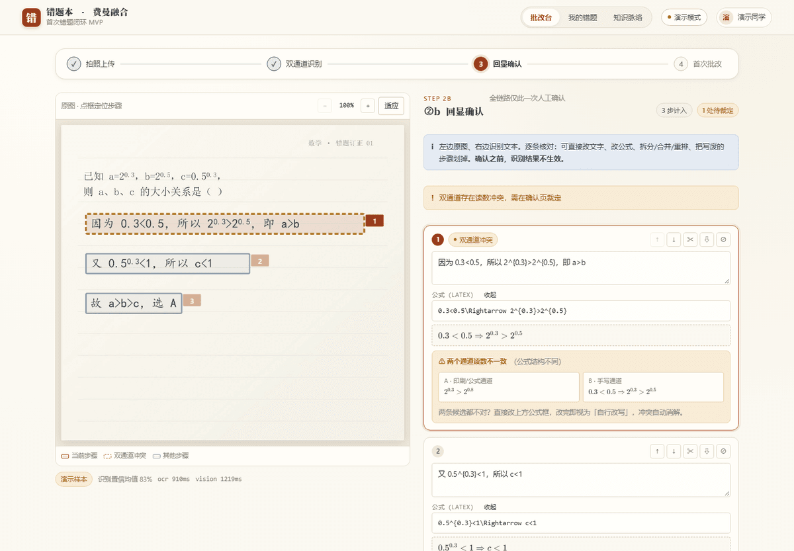
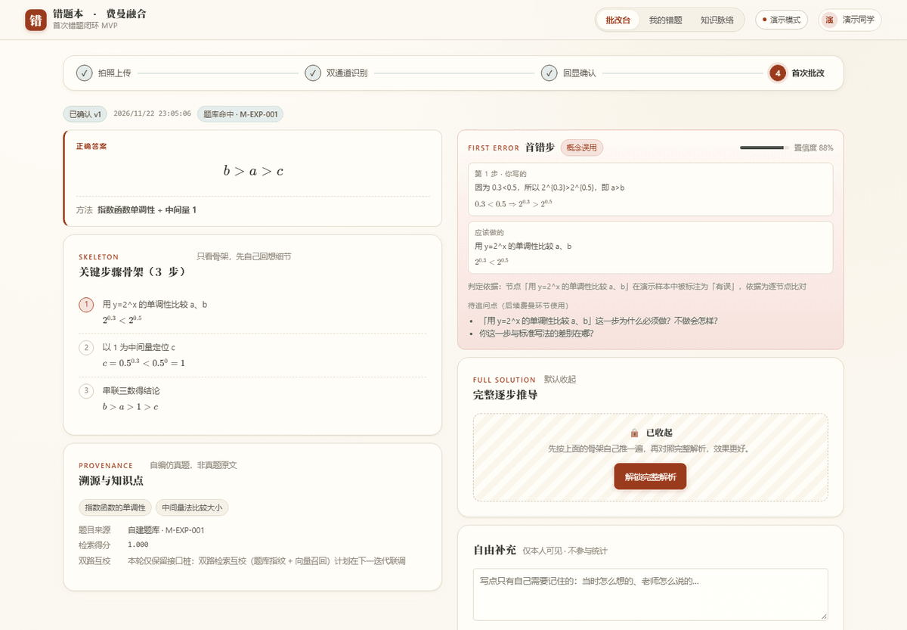
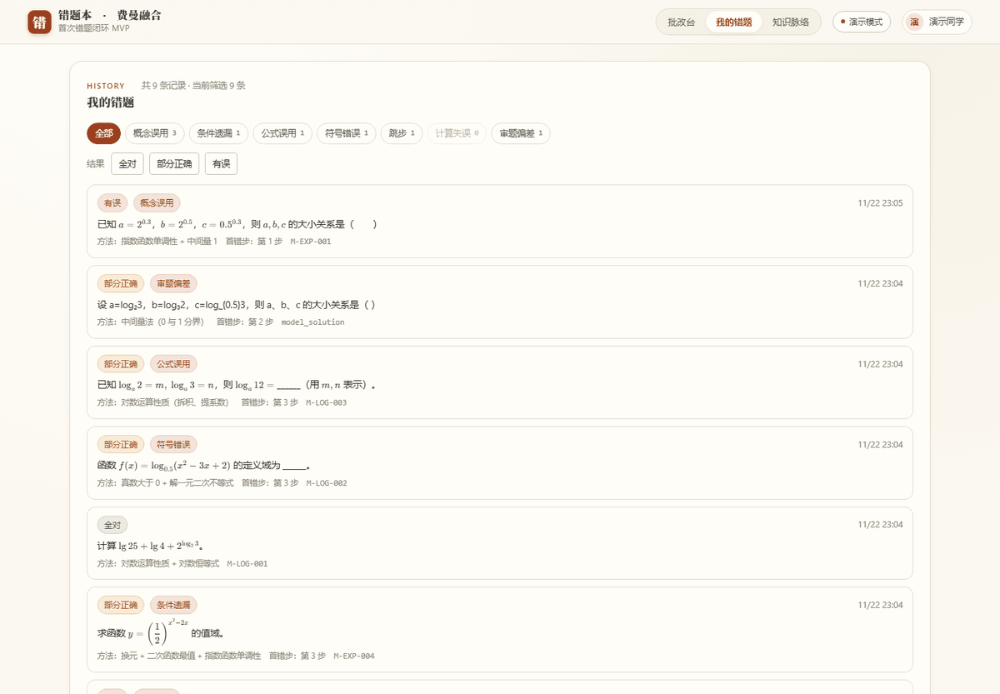
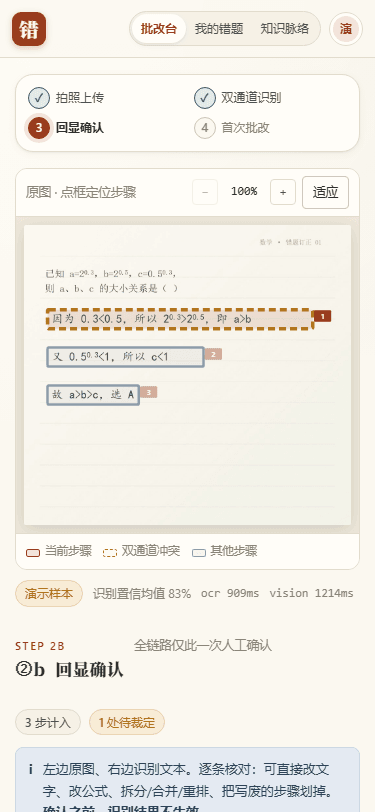

<div align="center">

# 错题本 · 费曼融合

**拍一张错题照片，先定位「错在哪一步」，再给一个七选一的错因标签。**

一个把「拍照 → 双通道识别 → 回显确认 → 题目定位 → 首次批改」做成单题闭环的网页应用。


</div>



## 这是什么

学生做完一道题、对答案发现错了，但「错在哪一步、为什么错」往往说不清。这个工具把这件事拆成五步，并且**只在学生确认过识别结果之后**才进入批改：

| 步骤 | 做什么 | 关键约束 |
|---|---|---|
| ① 拍照上传 | 客户端 EXIF 校正 → 长边 1800 压缩 → 感知哈希去重 → 归档 | 单张 ≤ 12MB |
| ② 双通道识别 | PaddleOCR-VL 读印刷题干/公式；GLM-5.3-Flash 读手写过程与切片 | 异步长任务，轮询进度 |
| ②b 回显确认 | 左原图（可缩放、bbox 高亮）右识别文本；可改字/改公式/拆分合并重排/划掉 | **不可跳过**，冲突必须裁定 |
| ③ 题目定位 | 题库指纹优先；未命中走模型自解并明确标注 | 命中才谈「原题」 |
| ④ 首次批改 | 答案 / 方法名 / 3–7 步骨架 / 首错步 / 错因主标签 | 完整推导默认收起 |

> **当前版本只做到 ④**。⑤ 艾宾浩斯调度、⑥ 费曼追问、⑦ PDF 归档、同类题推荐都只保留了置灰入口，没有实现。

## 界面

| 批改结果 | 我的错题 |
|---|---|
|  |  |

<p align="center">
  
  <br />
  <sub>375px 移动端：单列卡片、步骤条两行、编号贴框外不遮挡手写</sub>
</p>

## 快速开始

**环境要求**：Node.js ≥ 20（推荐 22）。

```bash
git clone <your-repo-url> cuoti && cd cuoti
npm ci                       # 用锁文件安装，保证 vite 5 + esbuild 0.21 的嵌套版本一致
cp .env.example .env         # Windows: copy .env.example .env
npm run dev
```

打开 <http://localhost:5173>，点「用演示账号体验」：

```
demo@cuoti.local / demo1234
```

在「演示样本」里点任意一张，就能走完 ①→④。**不配任何密钥也能跑**——此时使用 8 条标注样本，界面会明确标注「演示模式」，不会把 mock 结果伪装成真实识别。

生产模式（前端由 BFF 直接托管）：

```bash
npm run build
npm run check:secrets        # 扫描构建产物，确认没有模型密钥
npm start                    # http://127.0.0.1:8787
```

运行时数据都在 `data/`（SQLite + 上传原图），删掉即可重置。

### 接真实模型

```ini
# .env
PROVIDER_MODE=auto             # 三把密钥齐全自动切 live
SILICONFLOW_KEY_OCR=...        # PaddleOCR-VL
SILICONFLOW_KEY_DEEPSEEK=...   # 未命中题库时的自解兜底
ZHIPU_KEY_GLM=...              # GLM-5.3-Flash 手写通道
```

重启后在「右上角头像 → 设置 → 模型连接 → 测试连接」验证。探活只发 1 token 的请求，不会传输任何题目内容。三通道都显示「连通」即已接真实模型。

> 密钥只存在服务端 `.env`，前端不直连任何模型 API，日志也会脱敏。真题/考试原卷可在上传时勾选，按 `MODEL_EXAM_POLICY=block` 不送生成式模型。

## 技术栈

| 层 | 选型 | 说明 |
|---|---|---|
| 前端 | React 18 + Vite 5 + TypeScript | SPA，无 SSR；KaTeX 渲染公式 |
| 后端 | Node + Fastify 4 | BFF，统一网关封装三路模型调用 |
| 数据库 | SQLite（better-sqlite3，WAL） | 零运维，同步 API，适合单机 MVP |
| 鉴权 | JWT + refresh token | 邮箱 + 密码（scrypt 加盐） |
| 图片 | 本地目录（预留预签名接口） | 可平滑替换为 OSS/COS/S3 |

## 架构

```
Browser (React SPA)
   │  multipart 上传 / fetch + 轮询
   ▼
BFF (Fastify)
   ├─ /api/auth        注册、登录、refresh
   ├─ /api/uploads     去重归档（sha256 + 感知哈希）
   ├─ /api/recognize   ──► gateway.call('ocr')    ──► SiliconFlow
   │                   ──► gateway.call('vision') ──► Zhipu
   ├─ /api/solutions   学生确认 → ConfirmedSolution（唯一可信输入）
   ├─ /api/locate      题库检索 / 模型自解
   ├─ /api/grade       ──► 步骤对齐 + 首错步 + 标签
   └─ /api/models      三通道探活
   │
   ▼
SQLite (users / images / tasks / recognitions / confirmations / locates / gradings / notes)
```

## 目录结构

```
.
├─ apps/
│  ├─ web/                      # React 18 + Vite
│  │  └─ src/{pages,components,store,lib,styles}
│  └─ server/                   # Fastify BFF
│     ├─ src/gateway/           #   ocr / vision / reason 三通道 + 重试 + 探活
│     ├─ src/merge/diff.ts      #   双通道三级比对（字符/公式/切片）
│     ├─ src/grade/             #   步骤对齐、首错步、错因标签
│     ├─ src/store/db.ts        #   SQLite 仓储
│     ├─ src/bank/              #   题库、演示样本、学科脉络
│     └─ public/samples/        #   8 张演示样本图
├─ scripts/                     # 样本生成、端到端/多用户/UI/异常态自检
├─ docs/screenshots/            # README 截图
└─ .env.example
```

## 环境变量

| 变量 | 默认 | 说明 |
|---|---|---|
| `PORT` / `HOST` | `8787` / `127.0.0.1` | BFF 监听地址 |
| `DATA_DIR` | `data` | SQLite 与上传原图目录 |
| `JWT_SECRET` | 开发用占位串 | **生产必须替换** |
| `PROVIDER_MODE` | `auto` | `auto` / `mock` / `live` |
| `LLM_TIMEOUT_SEC` | `120` | 单次模型调用超时 |
| `MODEL_EXAM_POLICY` | `block` | 真题是否禁止送生成式模型 |
| `SILICONFLOW_BASE_URL` | 官方地址 | OCR / 推理通道 |
| `ZHIPU_BASE_URL` | 官方地址 | 手写视觉通道 |
| `MODEL_OCR` / `MODEL_GLM` / `MODEL_DEEPSEEK` | 见 `.env.example` | 模型名 |
| `RETRIEVE_MAX_ROUNDS` | `2` | 检索轮次上限（当前为占位） |

## 数据模型

| 表 | 作用 | 关键列 |
|---|---|---|
| `users` | 账号 | `email` 唯一、`password_hash`（scrypt + 盐） |
| `images` | 原图归档 | `owner_id`、`sha256`、`phash`、`sample_id`、`is_exam_question` |
| `tasks` | 异步任务 | `status` / `stage` / `progress` |
| `recognitions` | 识别快照 | `payload_json` |
| `confirmations` | ConfirmedSolution | `version`、`confirmed_at` |
| `locates` | 题目定位 | `confirm_id` 唯一 |
| `gradings` | 首次批改 | `primary_label`、`overall`、`first_error_step` |
| `notes` | 自由补充 | 仅本人可见、不入统计 |

所有查询都带 `owner_id`；跨账号访问统一返回 404，不泄漏「存在但无权」。

## API

前缀 `/api`，除注册/登录/元信息外均需 `Authorization: Bearer <access_token>`。

| 方法 | 路径 | 说明 |
|---|---|---|
| POST | `/auth/register` `/auth/login` `/auth/refresh` | 注册 / 登录 / 续期 |
| GET | `/auth/me` | 当前用户 |
| GET | `/meta` | 模式、样本、题库规模、功能开关 |
| POST | `/uploads/presign` | 预签名直传形态（MVP 返回本地代理） |
| POST | `/uploads` | 上传原图 → `image_uri` + 元数据 |
| POST | `/recognize` | 提交识别任务 → `task_id` |
| GET | `/tasks/:id` | 轮询进度 |
| GET | `/recognitions/:task_id` | 识别结果 |
| POST | `/solutions/confirm` | 学生确认 → ConfirmedSolution |
| POST | `/locate` | 题库定位 / 模型自解 |
| POST | `/grade` | 首次批改任务 |
| GET | `/gradings/:task_id` | 批改结果（不含完整推导） |
| GET | `/gradings/:task_id/derivation` | 解锁完整推导 |
| PATCH | `/gradings/:task_id/note` | 自由补充（仅本人可见） |
| GET | `/records` | 我的错题 + 标签统计 |
| GET | `/models/health` | 三通道探活 |

## 关键设计

**1. 确认不可跳过**
`POST /grade` 只接受 `confirm_id`，并校验它是最新版本。服务端三重拦截：`CONFIRM_REQUIRED`（没有确认）、`CONFLICT_UNRESOLVED`（冲突未裁定）、`STALE_CONFIRM`（旧版本）。代码里不存在「置信度高就自动通过」的分支。

**2. 不确定就标注**
低置信、无法辨认、题库未命中都是合法输出：低置信会附上依据，未命中会显式写明「未检索到原题，以下为模型独立解答」。宁可降低置信度，也不编造步骤或结论。

**3. 判分分两层**
文本相似度判不了数学对错——把 `<` 写成 `>` 只差一个字符，相似度几乎不变。所以：对齐层用公式覆盖率把学生步骤映射到标准解节点；判定层在演示样本里使用作者标注（相当于测试 oracle），学生一旦改动某一步，该节点立即回退到文本比对并标为低置信。

**4. 双通道互校是「标注」而不是「自动采纳」**
几何配对 + 归一化比对，产出字符 / 公式 / 切片三级差异。任何冲突都进入人工确认，不存在自动覆盖。

## 测试

```bash
npm run test:e2e        # ①→④ 全链路，8 条样本 + 两条硬约束
npm run test:users      # 多用户注册/登录/隔离（跨账号读数据必须 404）
npm run test:errors     # 异常态：演示模式上传非样本图片
npm run test:ui         # 1440 / 375 两档走查 + 截图（需 Edge 或 Chrome）
npm run check:secrets   # 构建产物密钥扫描
```

`test:ui` / `test:errors` 用 `puppeteer-core` 驱动本机浏览器，可用 `BROWSER_PATH` 指定可执行文件路径。

当前自检结果：

| 项 | 结果 |
|---|---|
| 端到端 | 8/8 样本通过（全对 · 概念误用 · 跳步 · 条件遗漏 · 符号错误 · 公式误用 · 审题偏差 · 未命中兜底） |
| 多用户隔离 | 20 条断言通过，跨账号 5 个接口全部 404 |
| 布局 | 1440 / 375 下 6 个页面 `scrollWidth == innerWidth`，0 console 报错 |
| 密钥 | 构建产物扫描 65 个文件，0 命中 |

## 已知限制

- **live 通道未用真实厂商密钥联调**：只用本地假上游（`npm run fake:upstream`）验证了请求构造、JSON 解析、503 指数退避重试与降级。填入真实密钥后请先跑「设置 → 测试连接」。
- **判分依赖 oracle**：真实模式下没有标注，仅文本比对，置信度会偏低。
- 未实现：艾宾浩斯调度、费曼追问、PDF 归档、同类题推荐、手机号验证码、家长/学生多档案。
- 物理学科脉络按人教 2019 版通用目录自拟，仅作导航，不含物理题库。
- 图片存本地目录，多实例部署需要换成对象存储。

## Roadmap

- [ ] 判分模型（`gateway.call('judge')`）替代文本比对
- [ ] 题库指纹升级为「文本 + 公式结构 + 图形区域」三路召回
- [ ] 对象存储预签名直传
- [ ] ⑤ 艾宾浩斯调度（复用 `error_localization.followup_seeds`）
- [ ] ⑥ 费曼追问与掌握度
- [ ] ⑦ PDF 归档

## License./

[MIT](LICENSE)
